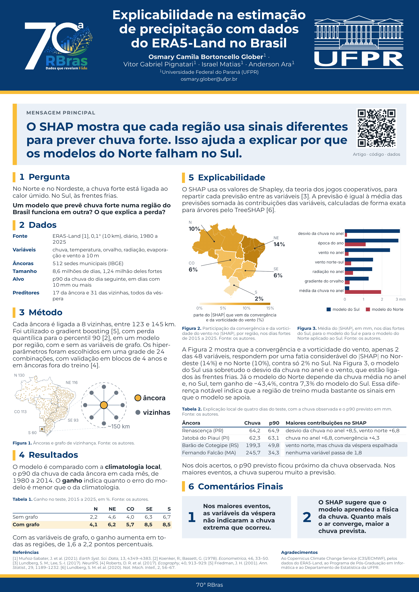

# Explicabilidade na estimação de precipitação com dados do ERA5-Land no Brasil

*Explainability in precipitation estimation with ERA5-Land data in Brazil*

Osmary Camila Bortoncello Glober, Vitor Gabriel Pignatari, Israel Matias e Anderson Ara
Universidade Federal do Paraná (UFPR)

Pôster apresentado na **70ª RBras**. Poster presented at the **70th RBras**.

| | |
|---|---|
| **Pôster** · *Poster* | [papers/rbras70_poster.pdf](papers/rbras70_poster.pdf) |
| **Versão estendida (artigo)** · *Extended version (paper)* | [papers/av1_artigo.pdf](papers/av1_artigo.pdf) |
| **Código** · *Code* | [av1/](av1/) |
| **Dados** · *Data* | ERA5-Land ([Copernicus](https://cds.climate.copernicus.eu/datasets/reanalysis-era5-land?tab=overview)), gerados pelos scripts de [av1/](av1/) |

[Português](#português) · [English](#english)

---

## Português

### Mensagem principal

O SHAP mostra que cada região usa sinais diferentes para prever chuva forte, e isso ajuda a
explicar por que os modelos do Norte falham no Sul.

Para ver os detalhes, comece pelo [pôster](papers/rbras70_poster.pdf). A
[versão estendida](papers/av1_artigo.pdf) traz o método completo, a validação, todas as
figuras e também um primeiro experimento, que estima a chuva do mesmo dia só a partir das
vizinhas.

### Em resumo

- **Dados.** ERA5-Land diário, de 0,1°, de 1980 a 2025, com 512 âncoras nas sedes
  municipais do IBGE, cada uma ligada a 8 vizinhas entre 123 e 145 km.
- **Alvo.** O percentil 90 (p90) da chuva do dia seguinte nos dias com 10 mm ou mais,
  previsto só com variáveis da véspera, sem latitude, longitude ou altitude.
- **Modelo.** *Gradient boosting* com perda quantílica, um modelo por região, com e sem as
  variáveis de grafo, e validação em blocos de anos e em âncoras fora do treino.
- **Resultado.** No teste, de 2015 a 2025, o ganho sobre a climatologia local é este.

  | | N | NE | CO | SE | S |
  |---|---|---|---|---|---|
  | sem grafo | 2,2 | 4,6 | 4,0 | 6,3 | 6,7 |
  | com grafo | 4,1 | 6,2 | 5,7 | 8,5 | 8,5 |

### Onde está cada parte do pôster

Todos os caminhos são relativos a [av1/](av1/).

| no pôster | script |
|---|---|
| Figura 1, âncoras e grafo | [amostra_brasil/escolher_ancoras.py](av1/amostra_brasil/escolher_ancoras.py), [experimentos/figura_grafo.py](av1/experimentos/figura_grafo.py) |
| Dados, 8,6 milhões de dias | [amostra_brasil/gerar_dataset_amostra.py](av1/amostra_brasil/gerar_dataset_amostra.py) |
| Preditores da âncora e das vizinhas | [experimentos/montar_features.py](av1/experimentos/montar_features.py) |
| Método, grade de 24 combinações e validação | [experimentos/treinar_p90.py](av1/experimentos/treinar_p90.py), [experimentos/validacao_espacial.py](av1/experimentos/validacao_espacial.py) |
| Tabela 1, ganho no teste | [experimentos/comparar_desenhos.py](av1/experimentos/comparar_desenhos.py) |
| Figura 2, convergência e vorticidade no SHAP | [experimentos/shap_teste.py](av1/experimentos/shap_teste.py) |
| Figura 3, modelo do Norte aplicado ao Sul | [experimentos/matriz_regioes.py](av1/experimentos/matriz_regioes.py), [experimentos/transferencia_shap.py](av1/experimentos/transferencia_shap.py) |
| Tabela 2, explicação local de quatro dias | [experimentos/shap_local.py](av1/experimentos/shap_local.py) |

O primeiro experimento da versão estendida, a floresta aleatória que estima a chuva do Sul
no mesmo dia, está em R, nas pastas [av1/R atualizado/](<av1/R atualizado/>) e
[av1/R atualizado pdp e ice/](<av1/R atualizado pdp e ice/>).

### Como reproduzir

Os dados não estão no repositório, porque passam de 14 GB. Eles são gerados a partir do
ERA5-Land horário, que pode ser baixado no Copernicus Climate Data Store.

1. Agregue o ERA5-Land horário ao dia, conforme o [DATA.md](DATA.md).
2. Gere a amostra do Brasil e rode os experimentos, na ordem descrita em
   [av1/LEIA-ME.md](av1/LEIA-ME.md).

As dependências são gerenciadas com [uv](https://docs.astral.sh/uv/) (`uv sync`).

### Como citar

> Glober, O. C. B.; Pignatari, V. G.; Matias, I.; Ara, A. Explicabilidade na estimação de
> precipitação com dados do ERA5-Land no Brasil. Pôster, 70ª Reunião Anual da Região
> Brasileira da Sociedade Internacional de Biometria (RBras), 2026.

### Outros materiais neste repositório

Antes do estudo do Brasil, o projeto começou com uma única célula sobre Curitiba, em
atividades da disciplina de Aprendizado de Máquina Explicável.

| pasta | o que é |
|---|---|
| [at2/](at2/) | tabela diária de Curitiba e árvore de decisão |
| [at3/](at3/) | chuva forte em Curitiba, com boosting quantílico e CP, ICE, LIME e SHAP |
| [commons/](commons/) | código comum às duas atividades |
| [scripts/](scripts/) | agregação do ERA5-Land horário ao dia e à semana |
| [notebooks/](notebooks/), [figures/](figures/) | análise exploratória e animações |
| [DATA.md](DATA.md) | as variáveis do ERA5-Land e como elas são agregadas (em inglês) |

---

## English

### Main message

SHAP shows that each Brazilian region relies on different signals to predict heavy rain,
which helps explain why models trained in the North fail in the South.

Start with the [poster](papers/rbras70_poster.pdf) for the overview. The
[extended version](papers/av1_artigo.pdf) (in Portuguese) has the full method, the
validation, all figures and a first experiment that estimates same-day rain from the
neighbours alone.

### In short

- **Data.** Daily ERA5-Land at 0.1°, 1980 to 2025, with 512 anchors at the municipal seats
  (IBGE), each linked to 8 neighbours 123 to 145 km away.
- **Target.** The 90th percentile (p90) of next-day rain on days with 10 mm or more,
  predicted from the previous day only, without latitude, longitude or altitude.
- **Model.** Quantile gradient boosting, one model per region, with and without the graph
  features, validated on blocks of years and on anchors left out of training.
- **Result.** On the 2015 to 2025 test, the gain over local climatology is as follows.

  | | N | NE | CW | SE | S |
  |---|---|---|---|---|---|
  | without graph | 2.2 | 4.6 | 4.0 | 6.3 | 6.7 |
  | with graph | 4.1 | 6.2 | 5.7 | 8.5 | 8.5 |

### Where to find each part

The code is in [av1/](av1/). The table in the Portuguese section above maps each figure and
table of the poster to the script that produces it, and
[av1/LEIA-ME.md](av1/LEIA-ME.md) gives the order to run them. The first experiment of the
extended version (a random forest in R) is in the two `av1/R atualizado*` folders.

### Reproducing

The data is not in the repository (over 14 GB). It is rebuilt from hourly ERA5-Land,
available from the Copernicus Climate Data Store. Aggregate it to daily files as described
in [DATA.md](DATA.md), then follow [av1/LEIA-ME.md](av1/LEIA-ME.md). Dependencies are
managed with [uv](https://docs.astral.sh/uv/) (`uv sync`).

### Other material

The project started from a single ERA5-Land cell over Curitiba, in coursework for an
explainable machine learning class: [at2/](at2/) and [at3/](at3/), with shared code in
[commons/](commons/). [DATA.md](DATA.md) documents the ERA5-Land variables and the
daily and weekly aggregation.
